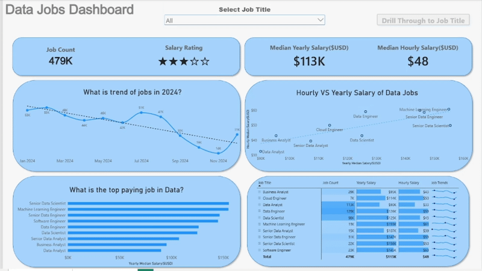
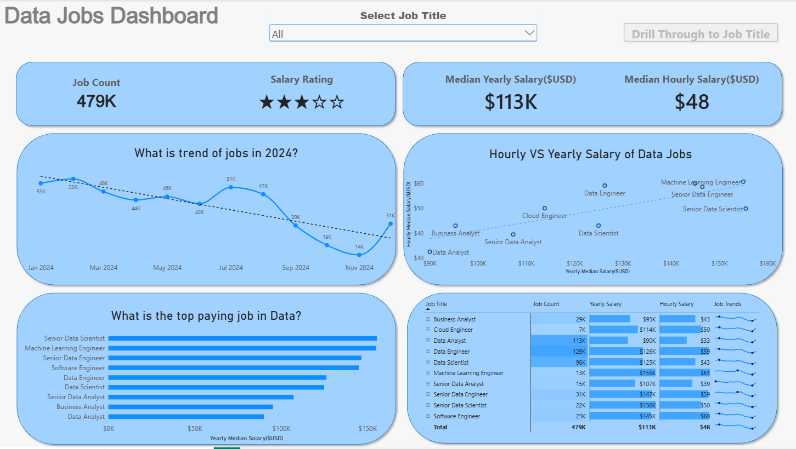
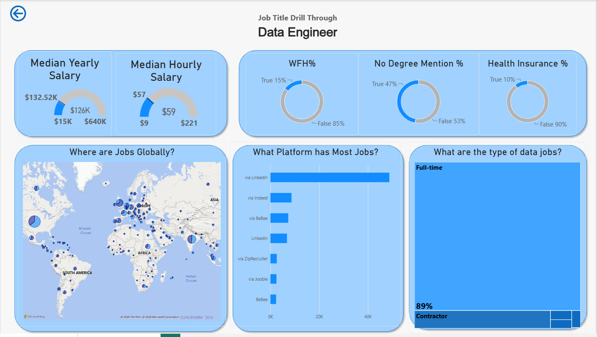

# Data Jobs Dashboard | Power BI

## Introduction

This is my first Power BI project, focused on analyzing the 2024 data science job market through an interactive dashboard.

Finding reliable information about data-related job opportunities, salaries, and market trends can be challenging. This project aims to make that information more accessible by transforming raw job posting data into meaningful insights.

Designed with **job seekers, career changers, and professionals exploring new opportunities** in mind, the dashboard provides an overview of job demand, salary distributions, popular job titles, and geographical trends.

### Dashboard File

You can find the complete Power BI project file here:

[**Data_Jobs_Dashboard.pbix**](data_jobs_dashboard.pbix)

## Skills & Tools Demonstrated

Throughout this project, I explored and applied several essential Power BI features and data visualization techniques:

- **⚙️ Data Transformation (ETL) – Power Query:** Cleaned and prepared raw data by handling missing values, adjusting data types, and creating new columns.
- **🧮 Measures & KPIs:** Used measures to calculate important metrics, including Median Yearly Salary and Job Count.
- **📊 Data Visualization:** Created Column, Bar, Line, and Area Charts to compare job demand and identify market trends.
- **🗺️ Geospatial Analysis:** Used Map Charts to explore the geographical distribution of data-related job opportunities.
- **🔢 Cards & Tables:** Presented key performance indicators and detailed job market information in an organized format.
- **🎨 Dashboard Design:** Built a clean, user-friendly dashboard with a focus on readability, visual hierarchy, and effective data storytelling.
- **🖱️ Interactive Reporting:**
  - **Slicers:** Enabled dynamic filtering by job title.
  - **Buttons & Bookmarks:** Added interactive navigation between dashboard views.
  - **Drill-Through:** Allowed users to move from high-level insights to detailed job-specific analysis.

---

## Dashboard Overview

The dashboard consists of two interactive pages, each designed to provide a different perspective on the data job market.

### Page 1: High-Level Market Overview

The first page provides a comprehensive overview of the data job market through key metrics and visualizations.

It highlights total job postings, median salaries, popular job titles, and other important indicators, helping users quickly understand the overall market landscape.

### Page 2: Job Title Drill-Through Analysis

The second page provides a more detailed analysis of individual job titles.

Using the Drill-Through feature, users can explore specific job roles and gain insights into salary distributions, remote work opportunities, popular hiring platforms, and geographical job locations.

---

## Conclusion

Building this project was an important step in developing my Power BI and business intelligence skills.

It gave me practical experience in transforming raw data into an interactive dashboard, applying different visualization techniques, and presenting information in a way that supports better decision-making.

As my first Power BI portfolio project, it represents another step in my journey toward becoming a professional Data Analyst.

**Special thanks to Luke Barousse for providing the learning resources and project guidance that helped me work through this project.**