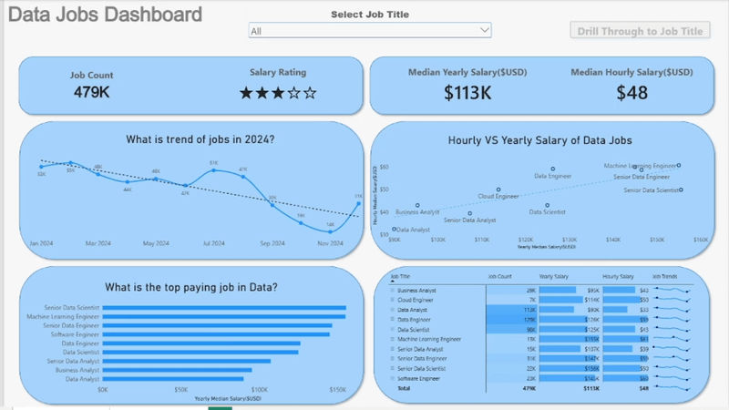
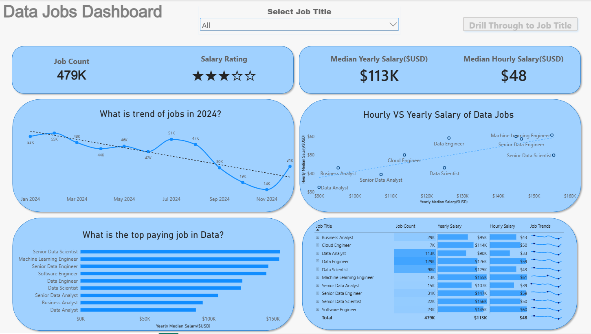
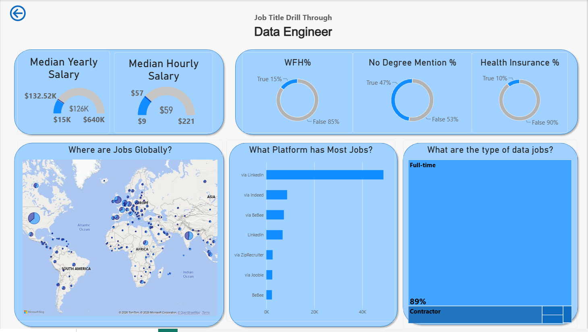
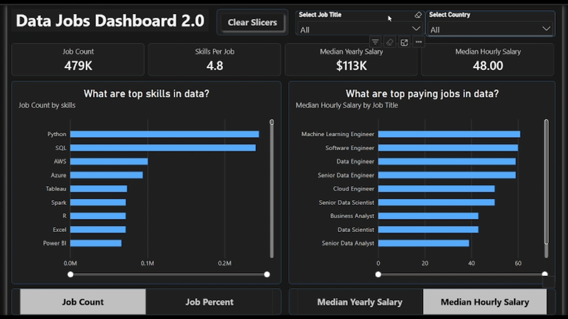

# Data Jobs Dashboard | Power BI (Version 1.0 & 2.0)

## Introduction

This project includes two versions of an interactive Power BI dashboard focused on analyzing the 2024 data science job market.

Finding reliable information about data-related job opportunities, salaries, in-demand skills, and market trends can be challenging. These dashboards aim to make that information more accessible by transforming raw job posting data into meaningful insights.

Designed with **job seekers, career changers, and professionals exploring new opportunities** in mind, the dashboards provide insights into job demand, salary distributions, popular job titles, skill popularity, remote work opportunities, and geographical trends.

The first version features a two-page interactive dashboard with detailed job title drill-through analysis. The second version (V2.0) introduces a more streamlined, single-page layout, bringing essential market insights together for a more focused user experience.

### Dashboard Files

You can find the complete Power BI project files here:

- [**Data_Jobs_Dashboard.pbix (Version 1.0)**](data_jobs_dashboard.pbix)
- [**Data_Jobs_Dashboard_2.0.pbix (Version 2.0)**](Dashboard_2.0.pbix)

## Skills & Tools Demonstrated

Throughout these projects, I explored and applied several essential Power BI features and data visualization techniques:

- **⚙️ Data Transformation (ETL) – Power Query:** Cleaned and prepared raw data by handling missing values, adjusting data types, and creating new columns.
- **🔗 Data Modeling:** Built data models and established relationships between tables using Star Schema principles.
- **🧮 Measures & KPIs – DAX:** Created measures and calculations to generate important metrics, including Job Count, Skills Per Job, Median Yearly Salary, and Median Hourly Salary.
- **📊 Data Visualization:** Created Column, Bar, Line, and Area Charts to compare job demand, analyze salary distributions, and identify market trends.
- **🗺️ Geospatial Analysis:** Used Map Charts to explore the geographical distribution of data-related job opportunities.
- **🔢 Cards & Tables:** Presented key performance indicators and detailed job market information in an organized format.
- **🎨 Dashboard Design:** Built clean, user-friendly dashboard layouts with a focus on readability, visual hierarchy, and effective data storytelling.
- **🖱️ Interactive Reporting:**
  - **Slicers:** Enabled dynamic filtering by job title and other relevant fields.
  - **Buttons & Bookmarks:** Added interactive navigation between dashboard views.
  - **Drill-Through:** Allowed users to move from high-level insights to detailed job-specific analysis.

---

## Dashboard Overview

The project consists of two dashboard versions, each offering a different approach to exploring the data job market.

### Version 1.0: Multi-Page Dashboard

The first version provides a comprehensive overview of the data job market through key metrics and visualizations.

It highlights total job postings, median salaries, popular job titles, and other important indicators, helping users quickly understand the overall market landscape.

### Page 2: Job Title Drill-Through Analysis

The second page provides a more detailed analysis of individual job titles.

Using the Drill-Through feature, users can explore specific job roles and gain insights into salary distributions, remote work opportunities, popular hiring platforms, and geographical job locations.

### Version 2.0: Single-Page Dashboard

The second version introduces a more streamlined, single-page dashboard designed to bring the most important job market insights together in one place.

It includes key performance indicators such as **Job Count, Skills Per Job, Median Yearly Salary, and Median Hourly Salary**.

Users can also explore **Skill Popularity** by job count or job percentage and compare salary distributions across different job titles.

This version focuses on simplifying the user experience while making essential market insights easier to access and explore.

---

## Conclusion

Building these two dashboard versions was an important step in developing my Power BI and business intelligence skills.

These projects gave me practical experience in transforming raw data into analysis-ready datasets, building data models, creating DAX measures, applying different visualization techniques, and designing interactive dashboards.

Developing Version 2.0 also helped me understand how dashboard design can be refined to present important information more efficiently and improve the overall user experience.

As part of my journey toward becoming a professional Data Analyst, these projects represent valuable hands-on experience in data analytics and business intelligence.

**Special thanks to Luke Barousse for providing the learning resources and project guidance that helped me work through these projects.**